# BPMVIZ

BPMVIZ is a process workshop workbench. You open a process in the browser, replay how a case moves through it, correct it with the people who run it, and capture pain points, opportunities, questions, decisions and actions against each step. At the end you save a portable engagement file and print a handoff summary for the client.

It runs from local files. There is no server, account, install or network connection, and nothing you type leaves your machine unless you save or export it, or start one of the optional AI tasks on your own Claude or ChatGPT subscription.

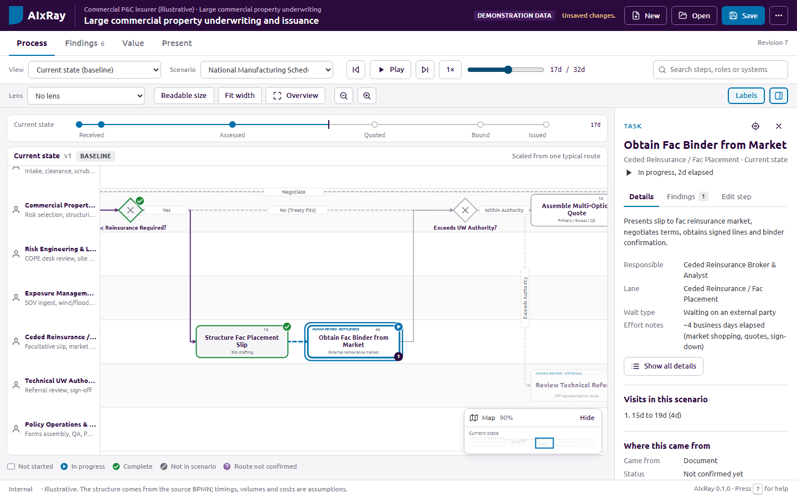

## Quick start

1. Download or clone this repository.
2. Open `webui/index.htm` in Chrome, Edge, Firefox or Safari. Double-clicking the file is enough.
3. Pick one of the bundled examples, or open an engagement file or a BPMN file.

To serve the app over HTTP instead, run `npm run serve` and open `http://127.0.0.1:8080/index.htm`. Both ways are tested.

## What you can do

### Replay the process honestly

Choose a scenario and play it, or drag the time slider. Each step shows its state with a symbol as well as a color: not started, in progress, complete, not in this scenario, or route not confirmed. A step that is visited twice (rework) shows the visit in progress, not the earlier one. A connector lights up only when the scenario actually used it. Lenses overlay elapsed time, human effort, waits, handoffs, SLA status, tagged bottlenecks or evidence coverage, and each lens says how many steps have data.

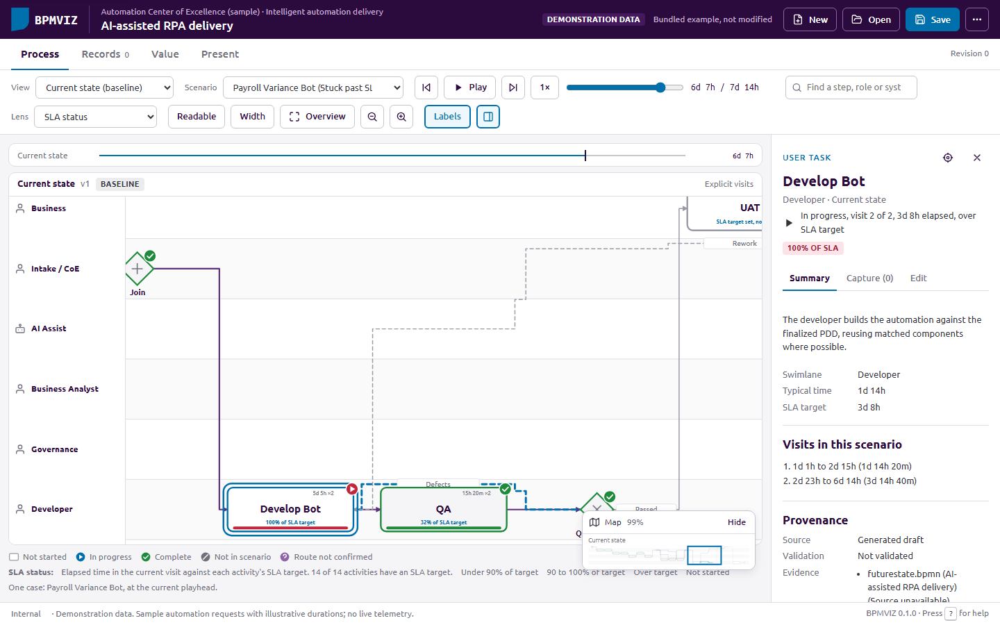

The default Readable view keeps labels legible. Overview fits every lane on screen for orientation and says when the labels are too small to read. Find locates a step by name, role or system, and the step list in the side panel mirrors the canvas for keyboard and screen-reader use.

### Capture findings against the steps

Select a step and use Capture to add a record while the client is talking. Records keep their link to the step, show as a count on the canvas, and collect in the Records workspace. Edit corrects the step itself: name, description, owners, systems, typed SLA and effort measures, wait type, provenance and evidence. Editing pauses playback.

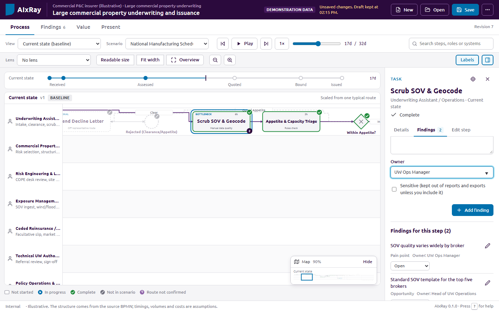

### Compare and redesign

When an engagement has a future state, compare it with the current state on one shared clock. To redesign, start a future-state draft from the current state: the current state becomes a locked baseline, and every step in the draft remembers where it came from. Changed, added and removed steps are marked, each with the reason you recorded, and selecting a step highlights its counterpart in the other pane.

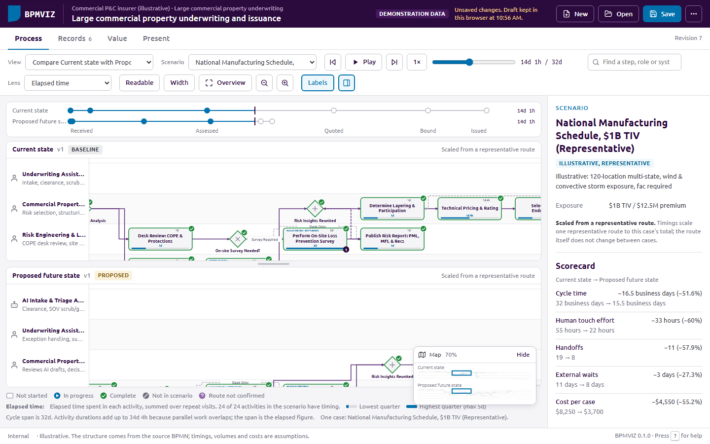

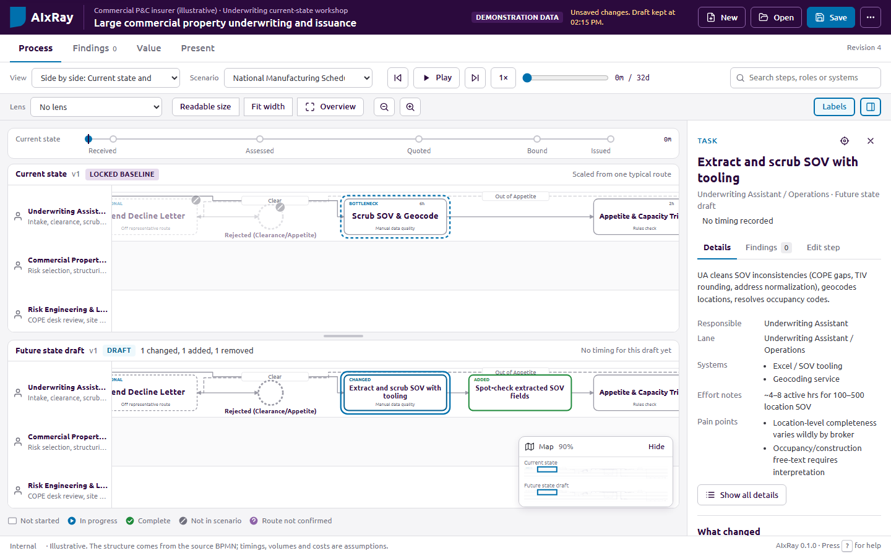

### Keep records, opportunities and evidence together

The Records workspace lists every record with filters for type, status, owner and step. The opportunity register asks for an intervention (eliminate, simplify, standardize and integrate come before automation and AI), why a simpler option is not enough, the expected benefit, effort, risk and the next validation step. The evidence register tracks sources and whether the client has validated them. Review lists what the validator and the source conversion flagged, and turns any item into an open question.

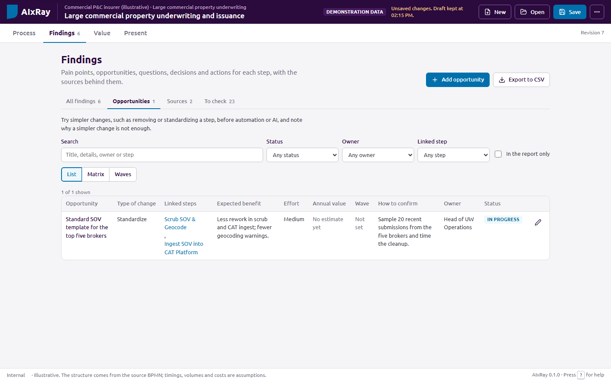

### Check the numbers

The Value workspace calculates cost per case, cost difference, redeployable capacity, cycle time reduction and payback from typed assumptions, and shows each formula with its inputs. A missing input leaves a result blank instead of assuming zero. Figures supplied with a scenario are checked against the assumptions: in the underwriting example, four of the five supplied future-state costs do not match the declared incremental AI cost, and the app shows the cost each one implies. A sensitivity table shows which inputs move a result most.

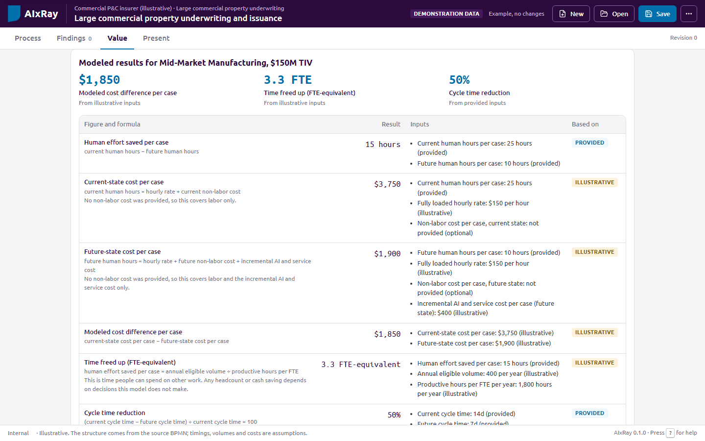

### Hand off

Present gives you a low-chrome presenter view and a printable handoff summary: scope and versions, data status, findings, opportunities, decisions, actions with owners, assumptions, modeled figures and evidence gaps. Records marked sensitive stay out unless you include them. Exports: engagement JSON, records CSV, process SVG and PNG.

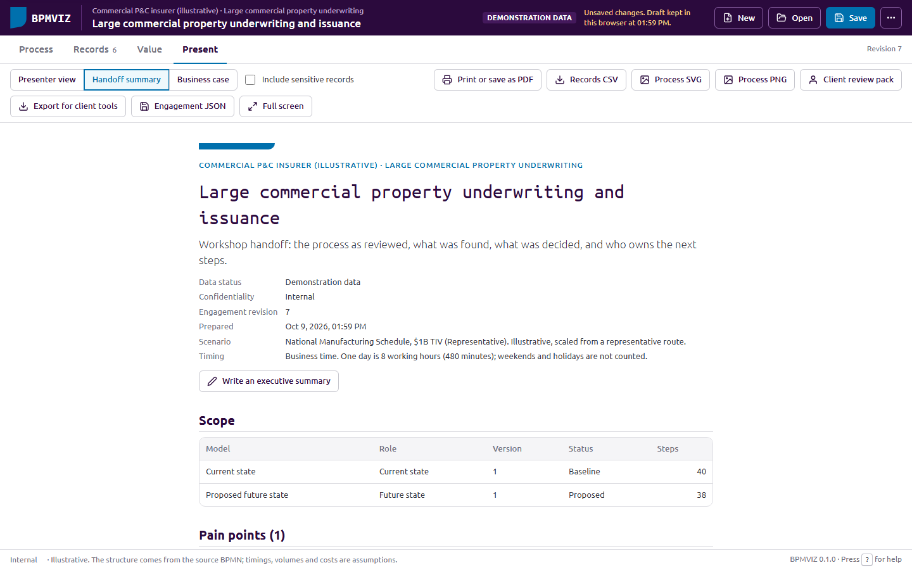

### Draft with AI on your Claude or ChatGPT plan

Claude Code (Claude Pro, Max, Team or Enterprise) or Codex (ChatGPT Plus, Pro, Business or Enterprise) can draft four things: a current state extracted from PDF, Word, PowerPoint, diagram images, notes or BPMN; suggested pain points, opportunities and questions; a future state as changes to the current state; and the executive summary for the handoff. BPMVIZ runs the tool you already use, on the account you signed in with, so no API key is involved and BPMVIZ never handles a credential.

```
npm run ai -- status
npm run ai -- extract intake-procedure.docx claims-flow.png --process-name "Claims intake" --yes
npm run ai -- opportunities --in claims.engagement.json --yes
```

Each task writes an AI result file. Open it in BPMVIZ with Open, look at each item and tick the ones you want; they go in as one change that Undo reverses. Applied items are marked as AI drafts and stay out of the handoff, presenter view and exports until someone reviews them. A reviewed AI summary prints with a line saying it was drafted with AI assistance.

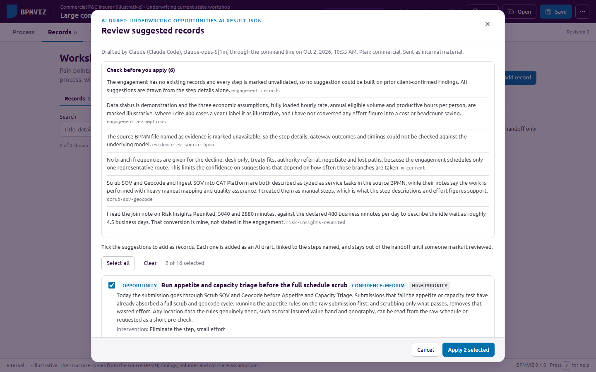

Client material goes only to commercial plans, with the engagement lead's approval; consumer plans take internal material only, with model training turned off. BPMVIZ checks this before anything is sent. The tool runs in a separate session with no shell, web access, hooks, plugins or MCP servers, and nothing is saved when it ends. The same tasks are available as agent skills in Claude Code and Codex, and as Draft with AI buttons when you start the app with `npm run serve -- --ai`.

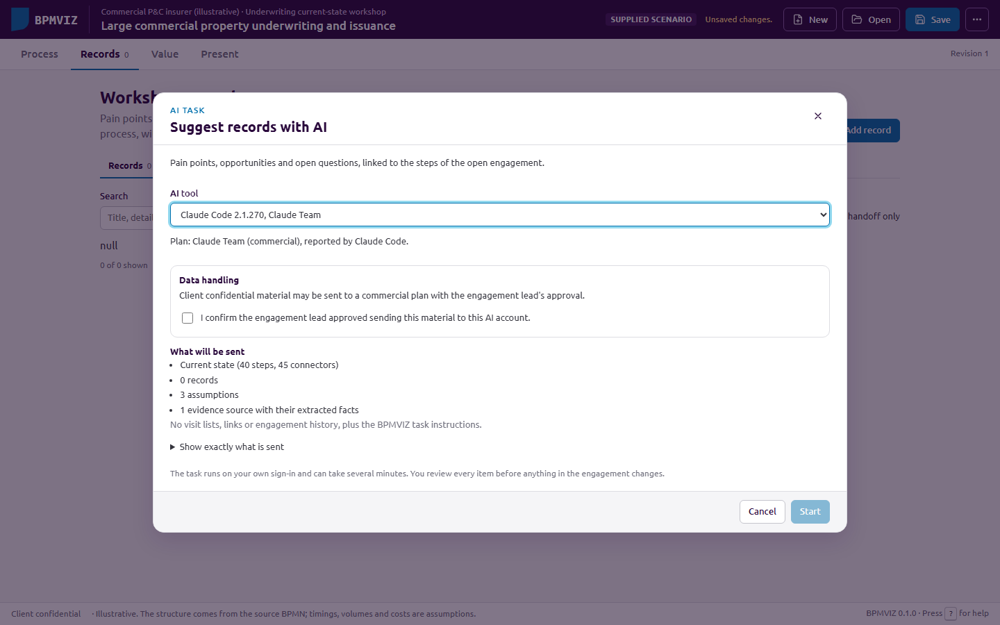

`docs/ai.md` covers setup, which plan may take which material, the options, the safety checks and troubleshooting.

### Measure the process from system data

If the client can export a log from the workflow, ticketing or core system that ran the process, BPMVIZ reads it and shows how the process actually ran: how many cases visited each step, how long each step took, which paths cases followed. This gives you real figures to show alongside what the workshop captured, instead of estimates only.

Open the engagement, then choose **More actions, Import an event log**, or just open the log file like any other file. A five-step wizard walks through the file, the columns, matching the log's activity names to the steps of your model, a few options, and a summary of what will be added. Nothing changes in the engagement until the last step. The figures then show on the canvas as two new lenses (observed share of cases, observed time per visit), in the side panel, in the value model and in the handoff.

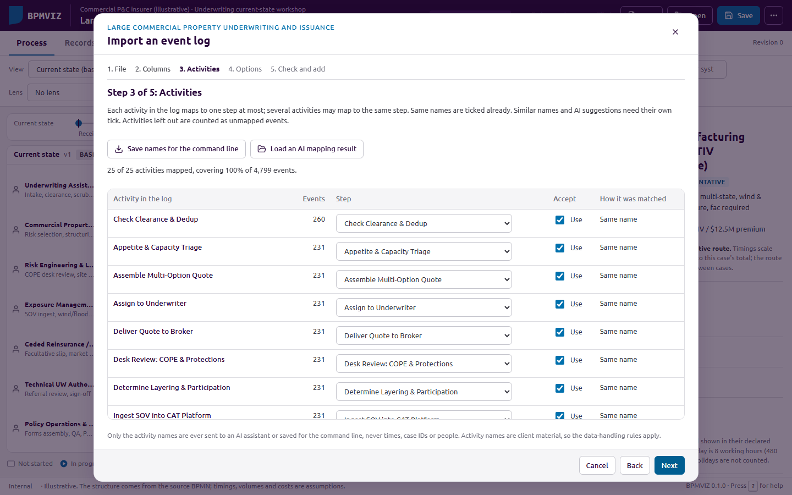

Only aggregates are kept: counts and times per step, never the individual events, case IDs or the names of people in the log. `docs/event-logs.md` covers the file formats, the timestamp rules, how activities are matched to steps, and what is and is not stored.

### Build the business case for an opportunity

Every opportunity in the register can carry a value case: typed or observed inputs for how much effort it saves, how many cases it affects, and what it costs to deliver. As you fill it in, BPMVIZ estimates the opportunity's annual value right away, using the same formula everywhere it shows up.

The **Matrix** view in Records, Opportunities charts every scored opportunity by value against effort, so you can see quick wins against major projects at a glance. The **Waves** view lays opportunities out by delivery wave (now, next, later) with a running total for each wave. The **Business case** present mode is a printable CFO one-pager: a portfolio page with the wave totals, or a single opportunity's own page with its headline figures and what is still missing.

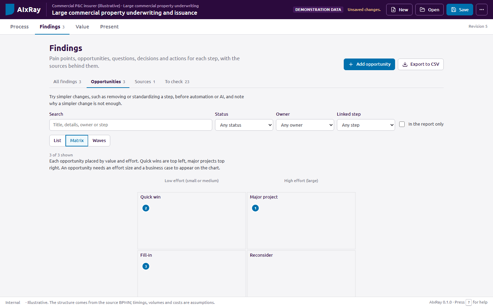

A missing input leaves a result blank rather than assuming zero, and every figure carries the basis of its weakest input (illustrative, supplied, observed or validated). See `docs/business-case.md` for the formulas and how ranking and the quadrants work.

### Check whether a change actually worked

Once you have an event log from before a change and another from after it, the **Benefits** section in the Value workspace compares the two: what each step actually took, and whether an opportunity's modeled value case was borne out. It never claims savings were "realized": a measured change can be confounded by seasonality, a different volume mix, or a mapping that drifted between the two periods, and the section lists those caveats next to every comparison. A read-only **Observed change** lens on the canvas marks each measured step faster, slower or about the same.

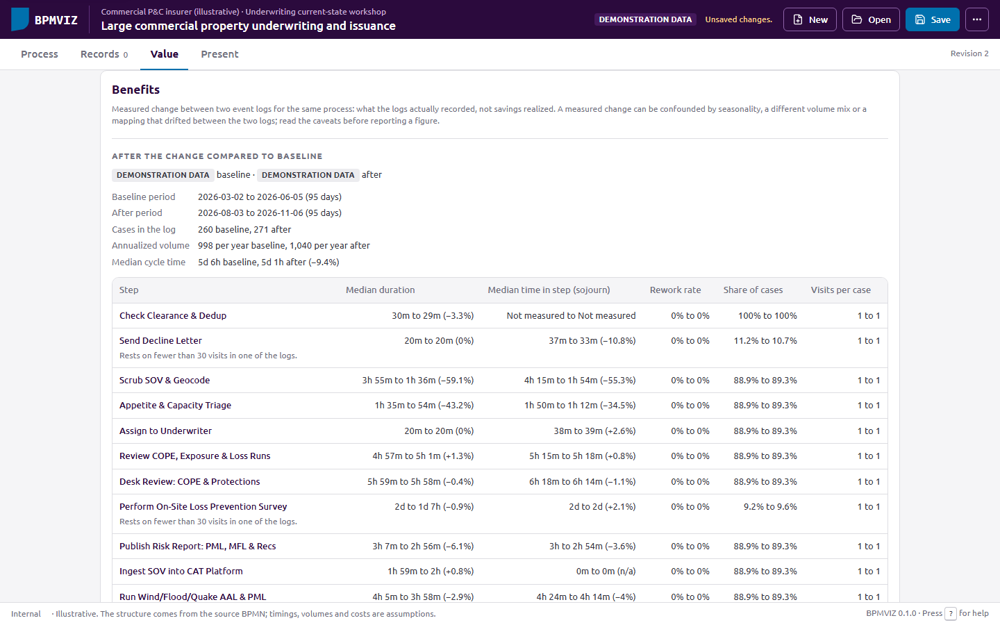

Start it from the Value workspace once the engagement has two event-log datasets. See `docs/benefits.md` for how the comparison is built and what each status (Met, Partially met, Not yet, Worse, Not measurable) means.

### Ask a client stakeholder to check the process

A client review pack lists the steps of a process model and the workshop's findings, and asks the reviewer to Confirm, Dispute or mark Not sure on each one, with a comment. Choose **Client review pack** in Present, pick a format (a web page that opens in any browser, or an Excel workbook), choose what to include, and send the file. The reviewer's answers come back as a file you open in BPMVIZ; applying them updates the validation status of the steps, can add open questions for disputed items, and can record the review as an evidence source.

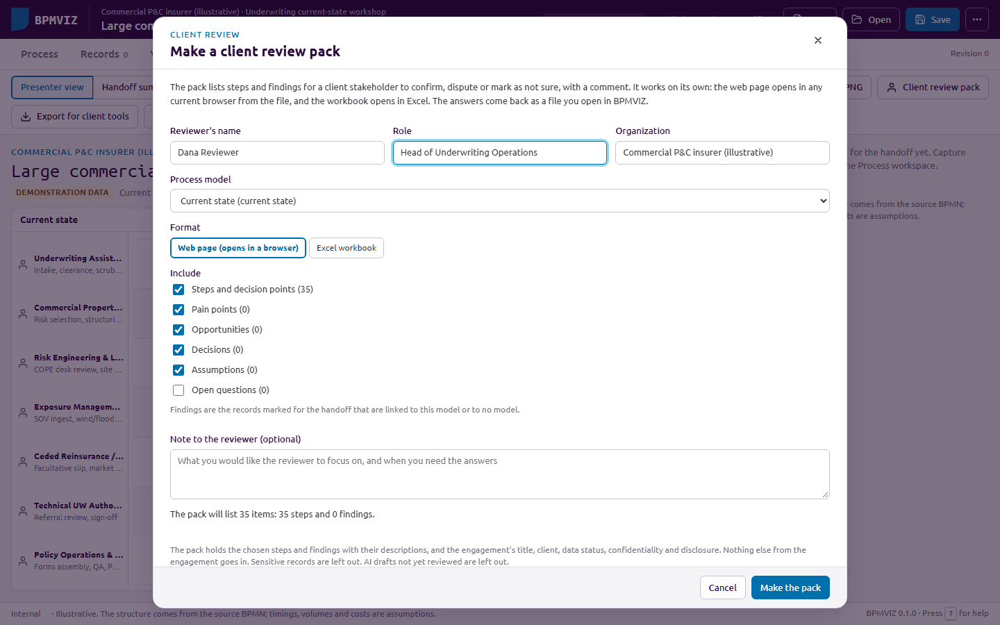

The pack carries only the steps and the findings chosen for it, plus the engagement's title, data status, confidentiality and disclosure. No figures, other records, evidence or notes go with it, and sensitive findings or unreviewed AI drafts are left out unless you explicitly include them. See `docs/client-review.md` for how the web page and the Excel workbook are kept safe, and how disagreeing responses are reconciled.

### Hand the process to the tools your client already uses

**Export for client tools**, next to Engagement JSON in Present, builds a PowerPoint deck, a BPMN 2.0 diagram, or a Jira, Azure DevOps or Excel backlog from the current engagement. It never changes the engagement, so there is nothing to undo.

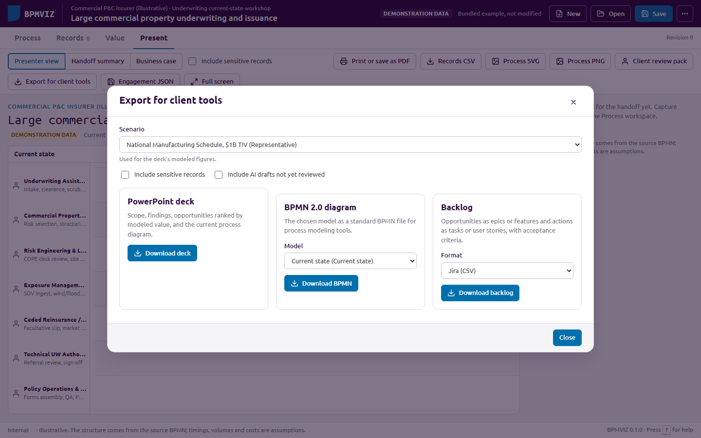

The deck covers scope, findings, opportunities with their modeled value, the wave plan, the current process diagram and next steps, built the same way every time so it opens cleanly in PowerPoint, Keynote or Google Slides. The BPMN export round-trips back through BPMVIZ's own importer. The backlog turns opportunities into epics or features and actions into tasks or stories, with acceptance criteria drawn from the value case. See `docs/exports.md` for what does and does not carry over.

## Your data

- **The engagement file you save is the record.** Use Save (Ctrl+S) often and store the file like any client document.
- **A recovery draft is kept in this browser** while you work, with a few earlier snapshots. It is not encrypted. On a shared machine, use More actions > Clear local data when you finish. If the browser blocks storage, the header says so and file save still works.
- **Opened files are treated as data.** Text is shown as text, only http and https links are kept, spreadsheet formulas are neutralized in CSV exports, and a file that fails validation is refused with the reasons while your open engagement stays as it was.
- **Nothing is fetched from the internet.** Fonts are bundled and the page's content security policy blocks outside connections. Opened from disk, the app cannot contact anything, even to run an AI task; it can still open AI result files.
- **AI drafts are labeled.** Records, future states and summaries drafted by an AI tool show as AI drafts until someone reviews them, and the handoff and exports leave them out until then.
- Every screen and export shows whether the content is demonstration data, a supplied scenario or observed data.
- **An imported event log keeps only aggregates.** The engagement never holds the log's individual events, case IDs or the names of people in it, only counts and times per step. Case IDs are hashed by default, and resources are left out unless you choose to count them, with no names stored either way. See `docs/event-logs.md`.
- **A client review pack carries only what you chose for it.** Steps, the findings you included, and the engagement's title, data status, confidentiality and disclosure; no figures, other records, evidence or notes. Sensitive findings and unreviewed AI drafts stay out unless included on purpose. The web page pack stores nothing in the browser and sends nothing anywhere. See `docs/client-review.md`.
- **Export for client tools never changes the engagement.** The PowerPoint deck, BPMN file and backlog it builds respect the same sensitive-record and AI-draft settings as the handoff. See `docs/exports.md`.

## Bring your own process

| Starting point | How |
|---|---|
| A BPMN 2.0 file | Open it. Lanes, events, tasks, exclusive and parallel gateways and sequence flows are imported with their BPMN IDs. Other elements are flagged, not dropped. BPMN has no timings, so replay is off until you add a scenario. |
| A process document, SOP, slides, diagrams or notes | Run `npm run ai -- extract <files>` on your Claude or ChatGPT subscription (see `docs/ai.md`), then open the result file. Or paste `tools/prompts/engagement-generator-prompt.md` into an AI assistant your organization approves for the material, and check what it returns with `npm run validate -- my-process.engagement.json`. |
| A reviewed template | New creates an engagement from one of the bundled examples without its records. |
| Files made with the old prompts | `npm run convert -- path/to/process.js`. See `archive/README.md`. |

The file format is documented in `webui/schema/engagement.schema.json`, and the bundled examples in `webui/examples/` are complete files to copy from.

## Keyboard

| Keys | Action |
|---|---|
| Tab, Enter | Move through steps on the canvas; open a step |
| Esc | Close the step panel and return to the step |
| Space | Play or pause |
| + and -, 0, W, F | Zoom; Readable view; fit width; Overview |
| Arrow keys, / | Pan the canvas; find a step |
| Ctrl+S, Ctrl+O, Ctrl+Z | Save, open, undo |
| ? | Help |

## Limits

- The replay shows the visits recorded in a scenario. It does not evaluate gateway conditions, simulate queues or predict throughput.
- Figures are only as good as their inputs. The app labels them illustrative, supplied or validated and checks their arithmetic; it cannot check whether an assumption is true.
- One person works on an engagement file at a time. There is no shared editing or approval workflow.
- The bundled examples are demonstrations. Their timings, volumes and costs are assumptions from the original samples.
- AI drafts are drafts. BPMVIZ checks their structure, traces their figures and blocks links and credentials, but it cannot tell whether a drafted step or opportunity is true. Review each one with the people who know the process.
- Automated tests run in Chrome, both from disk and over HTTP. Edge uses the same engine. Firefox and Safari should work but are not covered by the tests, and browsers differ in how they keep storage for pages opened from disk, which is why the saved file is the durable copy.

## Development

You need Node.js 20 or later. The browser tests and screenshot tool also need Chrome or Edge installed.

```
npm install              # installs playwright-core and pdfjs-dist, used only by the tests and tools
npm test                 # unit tests (node --test); the AI tests use fake claude and codex programs
npm run test:browser     # the app in Chrome, from disk, over HTTP and with the AI helper
npm run check            # Sogeti anti-style gate and the prose check
npm run ai -- --help     # AI tasks on your own Claude Code or Codex sign-in
npm run smoke:ai         # a real run on your sign-in with demonstration material, checking the safety points
npm run build:examples   # rebuild webui/examples from the archived samples
npm run screenshots      # regenerate docs/screenshots
```

The app has no build step. Every file under `webui/js/lib/` works both as a browser script and as a Node module, so the tests exercise the same code the app runs.

| Path | Contents |
|---|---|
| `webui/index.htm` | The app |
| `webui/js/lib/` | Model and logic: schema, validation, replay, layout, lenses, economics, store, persistence, exports, BPMN import, AI result files, event-log mining, the value case, benefits comparison, client review packs |
| `webui/js/ui/` | Interface: diagram, process workspace, side panel, forms, records, value and present views, AI review and tasks, event-log import wizard, opportunity value and the business case, the benefits section, client review and client exports |
| `webui/css/` | Design tokens (Sogeti palette and Ubuntu type) and app styles |
| `webui/examples/` | Bundled engagements, generated from `archive/` |
| `webui/schema/` | JSON Schemas for engagement files and AI result files |
| `tools/` | Validator, legacy converter, example and schema builders, screenshot tool, checks, prompts |
| `tools/ai/` | The AI runner, command line and local helper: Claude Code and Codex commands, document text, prompts, checks |
| `.claude/skills/`, `.agents/skills/` | The BPMVIZ agent skills for Claude Code and Codex |
| `tests/` | Unit tests, browser tests and fixtures |
| `docs/` | AI guide, event logs, the business case, benefits tracking, client review packs, exports, audit tracker, the September 2026 audit, sample event logs and screenshots |
| `archive/` | The earlier prototypes and prompts, kept for reference |

## Audit

This version implements the September 2026 product and architecture audit. `docs/AUDIT_TRACKER.md` lists every finding and backlog item with its status and the tests that cover it. The audit itself is in `docs/audit/`.

## Credits and license

BPMVIZ was created by Doug Ross; the original explorer and race explorer are in `archive/`. Released under the MIT License (see `LICENSE`). The interface follows the Sogeti design system. Ubuntu and Ubuntu Mono are used under the Ubuntu Font Licence 1.0 (`webui/fonts/UFL.txt`).
